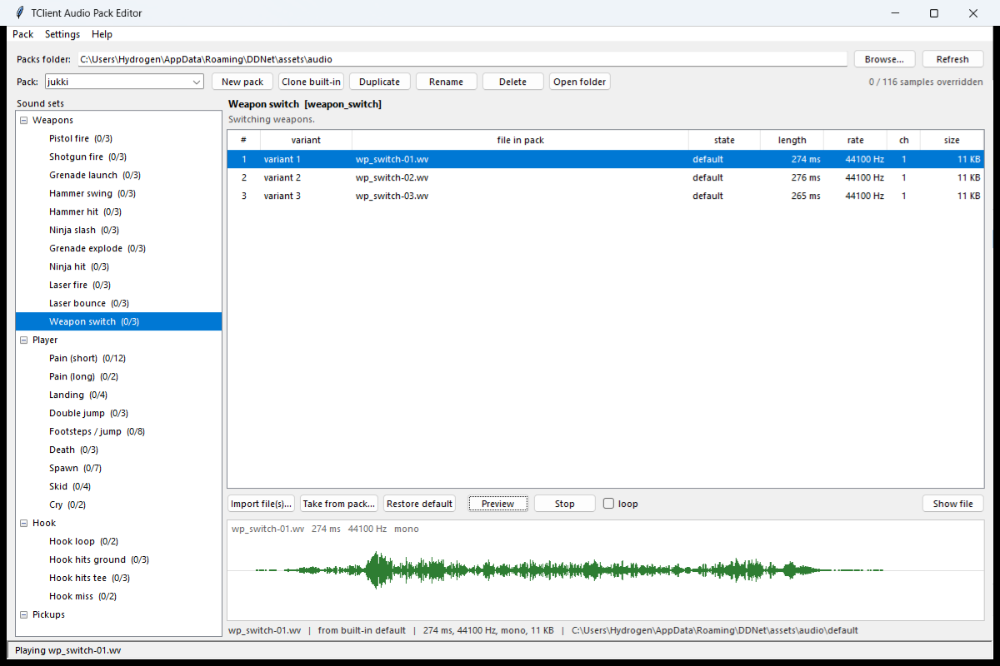
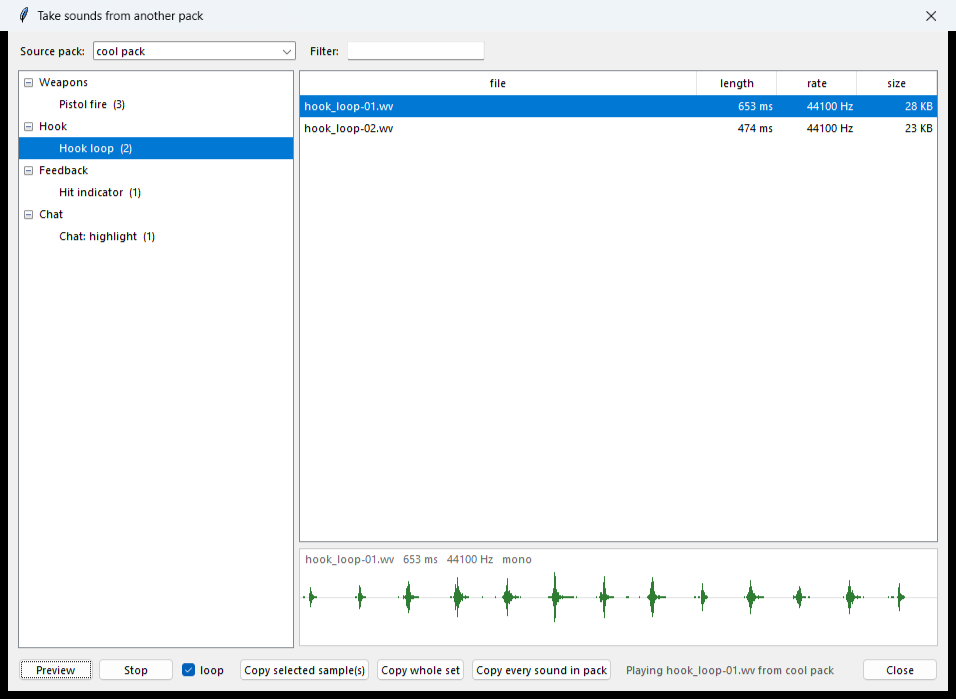

# TClient / DDNet audio pack editor

A per-sample editor for the client's audio asset packs (`assets/audio/<pack>`),
built the same way as the Weyes skin tool: point it at your config folder, pick
things from lists, write the result back.

Where Weyes swaps one eye strip across many skins, this tool gives you every
single sound slot of a pack and lets you set each one individually - import your
own file, lift it from another pack, or drop back to the built-in default.



## Download

Grab `dist/AudioPackTool.exe` and keep `dist/libwavpack-1.dll` next to it.
Both are in this repository; no installer, no Python needed.



## How the client handles audio

* The engine resolves every sound through the sound set table generated from
  `datasrc/content.py` (41 sets, 116 individual samples) and loaded by
  `src/game/client/components/sounds.cpp`.
* For each sample it looks for `assets/audio/<pack>/<filename>.wv` first and
  falls back to the built-in `data/audio` copy when the file is absent.
  The pack is chosen in game under Settings -> Assets -> Audio
  (`cl_asset_audio`).
* Decoding goes through WavPack (`src/engine/client/sound.cpp`, `DecodeWV`),
  which enforces **16-bit, mono or stereo**. Anything else is refused at load
  time, so the tool validates every file it writes.

Consequence: a pack is just a flat folder of `*.wv` files. No manifest, no index
- the folder *is* the project, and deleting a file restores the built-in sound.

## Running

```
python audio_pack_tool.py
```

or double-click `run.bat`. Requires Python 3.9+ with tkinter (standard on
Windows installers). No pip packages needed.

### WavPack library

Encoding and decoding use `libwavpack-1.dll`, the same library the client
ships. The tool looks for it next to itself, next to DDNet.exe/TClient.exe, in
`%LOCALAPPDATA%`/`%PROGRAMFILES%`, then in Desktop/Downloads/Documents. If it
cannot find one, set the path in **Settings -> WavPack DLL** (any DDNet install
has it).

`ffmpeg` is only needed for mp3/ogg/flac/opus imports; wav, aiff and wv work out
of the box.

## Using it

1. **Packs folder** - `%APPDATA%\DDNet\assets\audio` is detected automatically.
   `Browse...` if your client keeps its config elsewhere.
2. **Pack** - pick an existing pack, or `New pack` / `Clone built-in`.
   `Clone built-in` gives you a full copy of all 131 built-in samples, which is
   the easiest starting point for a complete pack.
3. **Sound sets** (left) - grouped by category. The counter shows how many
   samples of that set are overridden.
4. **Samples** (right) - one row per individual sample: the 12 pain grunts, the
   8 footsteps (4 left / 4 right), the 3 variants of each weapon sound, etc.
   Green rows live in your pack, plain rows come from the built-in set.
5. Actions:
   * `Import file(s)...` - wav/aiff/wv directly, mp3/ogg/flac via ffmpeg.
     Select several rows first to fill several variants at once; if you pick
     more files than rows, the remaining files fill the following variants of
     that set.
   * `Take from pack...` - copy a single sample, a whole set, or every
     overridden sound from another pack. The dialog previews the donor samples
     (button, double-click or Space) with their waveform, and has a `loop`
     toggle for long sounds like `hook_loop` or the menu music.
   * `Restore default` - delete the override.
   * `Preview` / double-click - decode and play, with the waveform drawn below.
     `loop` repeats (handy for `hook_loop` and menu music).
6. `Pack -> Validate current pack` re-decodes every file and reports anything
   the engine would reject.

Unreferenced `.wv` files that a pack may contain (the built-in set ships a few
legacy ninja/sledge voices) are listed under "Unused files in pack" so you can
spot or delete them.

## Import defaults (Settings)

* Resample to 0 / 44100 / 48000 Hz (0 keeps the source rate; the engine
  resamples at load time anyway)
* gain in dB, peak normalize, trim leading/trailing silence, short edge fade
* force mono
* fast or normal WavPack encoding

## Files

| file | purpose |
| --- | --- |
| `audio_pack_tool.py` | tkinter UI |
| `packstore.py` | pack/slot operations, import pipeline, validation, zip |
| `soundcatalog.py` | the 41 sound sets and their 116 sample file names |
| `wavpack_codec.py` | ctypes bindings for libwavpack (encode/decode/info) |

## Building a single exe

```
pyinstaller --onefile --windowed --name TCAudioPackTool --icon packtool.ico audio_pack_tool.py
```

The exe still needs `libwavpack-1.dll` at runtime - copy it next to the exe, or
let the tool find it in your client install.

## Notes

* The `default` folder inside `assets/audio` is hidden, exactly like in the
  game's asset menu; it is used as the fallback source.
* Sample rate does not have to match the built-in files - the engine converts
  on load.
* WavPack is BSD-3-Clause, the client's own data files stay untouched: the tool
  only ever writes inside the pack folder you selected.
